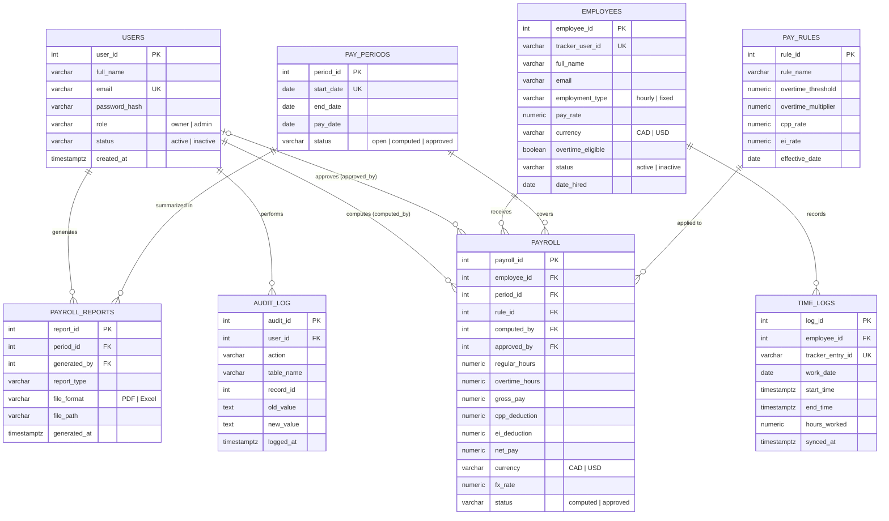

# IPTAS Database & Login Credentials

## Entity Relationship Diagram (ERD)

Image files: [`erd.png`](erd.png) (for Word/Google Docs) and [`erd.svg`](erd.svg) (sharp at any size).
Source: [`erd.mmd`](erd.mmd); the tables are defined in [`server/schema.sql`](../server/schema.sql).

## Tables
The database matches the ERD in Laboratory Exercise 005 exactly: 8 entities, 67 attributes, nothing added or left out.
Table names are plural (`users`) for the singular entities (USER). The tables map to the DFD data stores:
D1 = users, D2 = employees, D3 = time_logs, D4 = pay_rules, D5 = payroll, D6 = audit_log.

| Table | Purpose |
|---|---|
| `users` | System accounts that log in (Business Owner, Administrator) |
| `employees` | Remote workers being paid (hourly or fixed, CAD or USD) |
| `time_logs` | One time entry synced from Clockify. `tracker_entry_id` starts with `clockify-` (or `demo-` for sample data) |
| `pay_periods` | Semi-monthly pay periods: 1st–15th and 16th–end of month, paid 6 days after the period ends (open, then computed, then approved) |
| `pay_rules` | Versions of the overtime threshold and multiplier and the CPP/EI rates, by effective date |
| `payroll` | Computed pay of one employee for one pay period, with the currency and USD→CAD `fx_rate` used, and the PayPal payout (`paypal_batch_id`, `paypal_item_id`, `payout_status`, `payout_error`, `paid_at`) and the payment email (`receipt_token` = SHA-256 of the emailed link, `emailed_at`, `email_error`, `received_at` when the employee clicked Received) |
| `payroll_reports` | Log of PDF/Excel reports generated (`file_path` = the exported file) |
| `audit_log` | Who did what, and when (also holds the last time-log sync) |

How values not stored as columns are handled:
- **Net pay in CAD** = `net_pay × fx_rate`, calculated when shown.
- **CPP and EI** are deducted for employees paid in CAD (Canadian payroll); employees paid in USD have none.
- **USD→CAD rate** is entered when computing payroll and saved in `payroll.fx_rate`.
- **Company name, storefront URL, time zone and Clockify key** are server environment variables, not a table.
- **Account lockout** (5 wrong passwords → 15 minutes) is kept in server memory.

## Relationships

| From | To | Type | Foreign key |
|---|---|---|---|
| employees | time_logs | 1 to 0..many | `time_logs.employee_id` |
| employees | payroll | 1 to 0..many | `payroll.employee_id` |
| pay_periods | payroll | 1 to 0..many | `payroll.period_id` |
| pay_rules | payroll | 1 to 0..many | `payroll.rule_id` |
| users | payroll (computes) | 1 to 0..many | `payroll.computed_by` |
| users | payroll (approves) | 0..1 to 0..many | `payroll.approved_by` |
| pay_periods | payroll_reports | 1 to 0..many | `payroll_reports.period_id` |
| users | payroll_reports | 1 to 0..many | `payroll_reports.generated_by` |
| users | audit_log | 1 to 0..many | `audit_log.user_id` |

`payroll` has a unique rule on (`employee_id`, `period_id`), so an employee is paid once per period.

## User credentials (for the project submission)

These accounts are created automatically the first time the app starts on an empty database.

| Role | Email | Password | Can do |
|---|---|---|---|
| Owner | `owner@iptas.app` | `Owner@2026` | Everything, including approving payroll and settings |
| Payroll Administrator | `admin@iptas.app` | `Admin@2026` | Manage employees, sync time logs, compute payroll, reports |

Do not put the database connection string (`DATABASE_URL`) in the submission or in this repository. It stays in `.env` and in Render's environment variables.
