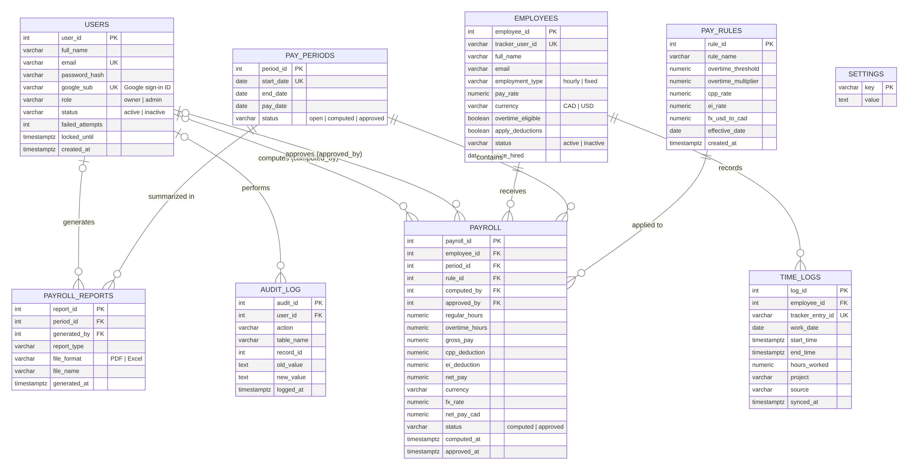
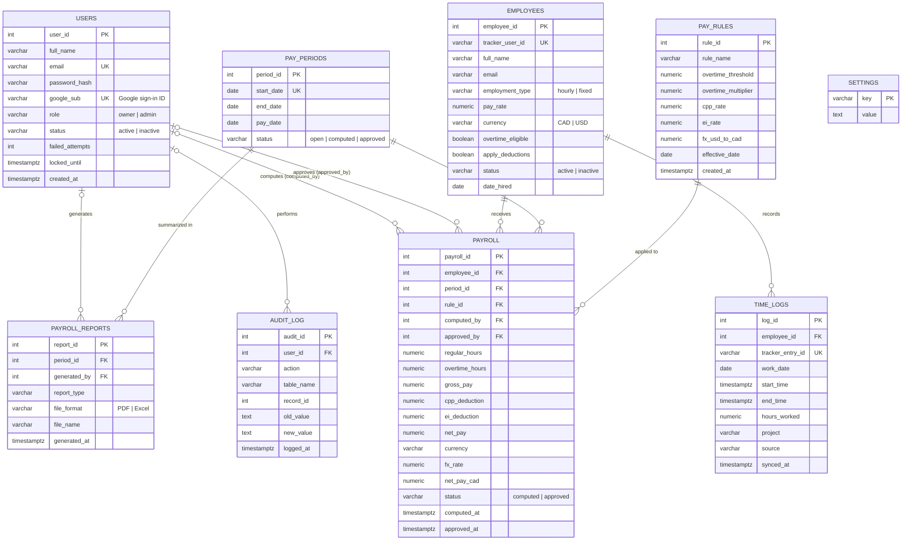

# IPTAS Database & Login Credentials

## Entity Relationship Diagram (ERD)

Image files: [`erd.png`](erd.png) (for Word/Google Docs) and [`erd.svg`](erd.svg) (sharp at any size).
Source: [`erd.mmd`](erd.mmd); the tables are defined in [`server/schema.sql`](../server/schema.sql).

## Tables

| Table | Purpose |
|---|---|
| `users` | System accounts that log in (Owner, Payroll Admin), with password and optional Google sign-in (`google_sub`) |
| `employees` | Staff who get paid (hourly or fixed, CAD or USD) |
| `time_logs` | Hours worked. `source` is `clockify` (synced from the API), `manual` (added by a user) or `demo` (sample data) |
| `pay_periods` | Two-week pay periods (open, then computed, then approved) |
| `pay_rules` | Overtime, CPP/EI deduction rates and USD-to-CAD rate |
| `payroll` | One computed pay record per employee per pay period |
| `payroll_reports` | Log of PDF/Excel reports generated |
| `audit_log` | Who did what, and when |
| `settings` | App settings: company name, storefront URL, business time zone, Clockify key and workspace, demo mode, last sync |

## Relationships

| From | To | Type | Foreign key |
|---|---|---|---|
| employees | time_logs | 1 to many | `time_logs.employee_id` |
| employees | payroll | 1 to many | `payroll.employee_id` |
| pay_periods | payroll | 1 to many | `payroll.period_id` |
| pay_rules | payroll | 1 to many | `payroll.rule_id` |
| users | payroll (computes) | 0..1 to many | `payroll.computed_by` |
| users | payroll (approves) | 0..1 to many | `payroll.approved_by` |
| pay_periods | payroll_reports | 1 to many | `payroll_reports.period_id` |
| users | payroll_reports | 0..1 to many | `payroll_reports.generated_by` |
| users | audit_log | 0..1 to many | `audit_log.user_id` |

`payroll` has a unique rule on (`employee_id`, `period_id`), so an employee is paid once per period.

## User credentials (for the project submission)

These accounts are created automatically the first time the app starts on an empty database.

| Role | Email | Password | Can do |
|---|---|---|---|
| Owner | `owner@iptas.app` | `Owner@2026` | Everything, including approving payroll and settings |
| Payroll Administrator | `admin@iptas.app` | `Admin@2026` | Manage employees, sync time logs, compute payroll, reports |

Do not put the database connection string (`DATABASE_URL`) in the submission or in this repository. It stays in `.env` and in Render's environment variables.
